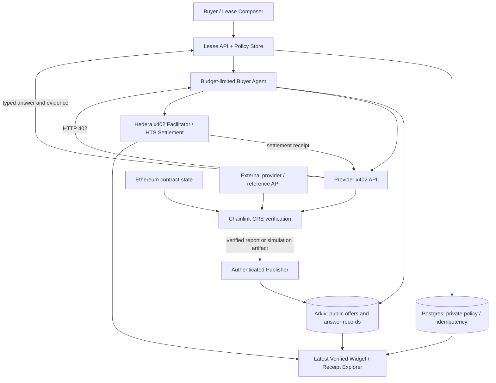

# DATA LEASES — Product & Engineering Specification

> **Working title:** Data Leases  
> **Tagline:** **Rent the answer. Not the team.**  
> **Version:** 1.0 — ETHGlobal Mumbai 2026 implementation spec  
> **Prepared:** 2026-11-06  
> **Primary sponsor stack:** **Hedera x402 + Arkiv + Chainlink CRE**  
> **Status:** Build-ready specification; some SDK signatures / endpoint options must be validated against installed versions.

---

## 0. Executive summary

**Data Leases** is an open marketplace and execution layer for recurring, evidence-backed data answers. A buyer does not purchase an entire analytics subscription, hire a research team, or trust an unaccountable dashboard. Instead, the buyer creates a **lease** specifying a precise question, source requirements, a freshness threshold, a cadence, a per-run ceiling, a total budget, and an end date.

Compatible analytics providers publish machine-readable offers. An autonomous buyer agent discovers eligible providers, evaluates their pricing and reliability, and **pays for a request through Hedera x402**, within a previously authorized spending policy. The provider delivers a structured answer and evidence bundle. **Chainlink CRE** validates an objectively checkable portion of the answer against independently accessible Ethereum state and an external source. Accepted reports become searchable, time-scoped **Arkiv** entities with provenance and a linked Hedera payment receipt. A widget reflects the latest accepted answer, spend, freshness, and status. The lease ends when expired, canceled, exhausted, or completed.

**One-sentence differentiation:** An interoperable market for *contracted, recurring, independently checkable answers*, combining autonomous per-request settlement, reproducible verification, and public-safe machine-readable receipts—not another AI finance terminal.

### Product principles

1. **Buy an answer, not a subscription.** Each run is a separate, priced delivery; ongoing use is a bounded lease.
2. **Verification must have an explicit meaning.** A label such as `verified` applies only to checks actually performed. LLM commentary is not a proof.
3. **Provider discovery is open.** Any qualified provider can publish an offer; the buyer does not have to trust a single proprietary data vendor.
4. **Money is real, testnet data is labeled.** Demonstrate real Hedera testnet settlement; label example metrics, mock providers, and simulations.
5. **No silent overspending.** Preauthorized budgets cap agent choices, but offchain limits are only as strong as wallet custody and key security.
6. **Arkiv is product data, not a decorative log.** Offer discovery, latest accepted answers, lease lifecycle and receipts must be queried from Arkiv in user-visible features.
7. **CRE has a concrete validation job.** It checks a reference block and selected independent measurements, not merely forwarding a provider's claim.
8. **No guarantee of post-delivery quality from x402 alone.** Payment-before-delivery and pay-after-acceptance are separate settlement models.

### Non-goals for the hackathon

No public token launch; no Hedera Asset Tokenization Studio; no trading or investment recommendations; no full multichain indexer; no guaranteed confidential computing; no general-purpose dispute court; no fiat checkout; no mandatory onchain escrow for every lease; no requirement to verify subjective claims through consensus; no attempt to mirror all Ethereum transactions to Arkiv.

---

## 1. The problem and customer

### Current alternatives

- **Full analytics subscriptions:** recurring fixed cost even for a handful of continuously monitored questions.
- **Custom analytics work:** a team writes queries, operates an indexer, monitors failures, and maintains evidence.
- **Single-vendor APIs:** pay for API access but usually must trust the vendor's computations, freshness and continued availability.
- **One-off AI analyst:** returns plausible narratives but may omit reproducibility, methodology, correct block references, and stable costs.

### Initial customer profiles

| Persona | Goal | Main constraint | Buying trigger |
| --- | --- | --- | --- |
| Solo DeFi researcher | Track a few specific risk metrics | Cannot justify premium analytics subscriptions | Wants a reliable widget updated every hour |
| DAO treasury analyst | Watch leverage / liquidity / treasury parameters | Needs checkable evidence and spend approval | Must justify decisions to other signers |
| Research agent developer | Obtain paid, well-typed analytical facts | No API-key procurement and per-agent billing | Agent needs data from external sellers |
| Independent data provider | Monetize specialized analytics | Doesn't want enterprise sales or billing integration | Can publish a pay-per-call endpoint |
| RWA analyst (later) | Monitor externally attested debt or collateral status | Data confidentiality and source reliability | Needs a contractual, verifiable metric |

### Initial beachhead

**Ethereum DeFi monitoring with small deterministic queries.** The first shipped lease will follow the current liquidity and utilization of a selected lending reserve on Ethereum, using clearly versioned addresses, ABI definitions and known source blocks. Extend to more markets only after completing the full payment-to-receipt loop.

### What the buyer is actually purchasing

A **run contract** specifies `question`, `measurement`, `units`, `source policy`, `verification policy`, `delivery deadline`, `price`, `maximum acceptable age`, and `license / usage scope`. The provider promises to deliver a typed result and provenance. The payment buys the provider's request execution; **independent acceptance is a separate status**, unless the parties adopt a future escrow-backed quality guarantee.

---

## 2. Product model

### 2.1 Key concepts

| Term | Meaning |
| --- | --- |
| **Question Template** | Machine-checkable definition of a metric, its units, inputs, and acceptance rules. |
| **Provider** | Independent operator offering a compatible paid analytics endpoint. |
| **Offer** | Public service listing with per-run price, currency, schema, expiry, supported questions, evidence contract and SLA. |
| **Lease** | User-authorized recurring request policy with budget, schedule, provider selection policy and end conditions. |
| **Run** | One scheduled attempt to obtain an answer under a lease. |
| **Answer** | Typed metric value(s) and associated timestamp, source block, methodology and provider signature. |
| **Verification Report** | CRE-driven result of specific checks, plus reason codes and evidence references. |
| **Data Receipt** | Public-safe, queryable Arkiv record linking accepted answer, methodology, provenance and run. |
| **Payment Receipt** | Verified Hedera x402 settlement transaction linked to a specific request and provider. |
| **Lease Widget** | Buyer-facing visualization backed by the latest accepted Arkiv answer and lease state. |

### 2.2 Main roles

- **Buyer:** creates lease, defines budget, selects source and verification standards, cancels, reviews spend.
- **Buyer agent:** discovers offers, compares terms, requests payment quotes, enforces budget, signs and retries x402 calls, retrieves answers.
- **Provider:** registers service metadata on Arkiv, operates a paid endpoint, signs answers, supplies evidence and customer support.
- **Verification workflow:** runs deterministic checks through CRE; returns a machine-readable report.
- **Indexing / publication worker:** writes public-safe entities to Arkiv; detects missed, duplicate and stale runs.
- **Optional overseer:** resolves service credits or flagged evidence disputes through an explicit, non-deceptive offchain administrative process in MVP.

### 2.3 Lease lifecycle

`DRAFT → ACTIVE → RUN_PENDING → QUOTED → PAID → DELIVERED → VERIFYING → ACCEPTED / REJECTED / INCONCLUSIVE`

A run terminal state returns the parent lease to `ACTIVE` if budget and time remain. Parent lease can become `PAUSED`, `EXHAUSTED`, `EXPIRED`, `CANCELED` or `COMPLETED`.

**Important:** A run can be `PAID` and later `REJECTED`. Those are independent facts. The interface must never relabel it “refunded” unless an actual compensating payment is proven.

---

## 3. Sponsor architecture and prize fit

### 3.1 Hedera — payment settlement layer

**Target prize:** **AI Agents That Pay: x402 on Hedera** ($6,500 total pool on the published Mumbai prize page).

Use official `@x402/hedera` integration and a documented facilitator. Hedera's purpose is **actual autonomous transaction settlement**, not data verification.

Required evidence:

- At least one x402-gated provider resource, settled on Hedera testnet.
- A buyer agent completes a paid request without interactive human approval at execution time.
- A real Hedera transaction ID and HashScan link in the README and demo.
- An authenticated quote, enforced spending limits, per-merchant restrictions and transaction reconciliation.

Nice-to-have sponsor extras only after MVP: HCS spending audit topic; HCS-14 or ERC-8004 identity; Hedera Agent Kit; merchant fee splits. **Do not prioritize these ahead of a working x402 payment.**

**Currency:** Hedera testnet USDC / another documented supported HTS fungible token; pick the exact asset ID **only after confirming its compatibility with the selected facilitator**. The legacy `hedera-dev/x402-hedera` example references testnet USDC token `0.0.429274`; independently confirm the actual token and decimals. Do not assume illustrative asset IDs in documentation are production values. Ensure sender and receiver token associations are set up where required.

**Primary settlement design (MVP):** Provider bills **per delivered response request**, with payment performed before delivering the response according to x402. The buyer's control is a bounded payer account with a server-side spending policy. The payer account's private key must never enter the browser.

### 3.2 Arkiv — public-safe shared marketplace and answer state

**Target prize:** **Build on Arkiv (from scratch)** ($4,000 track pool).

Arkiv is the **authoritative public data plane for offers and accepted public answer receipts**, not only a redundant audit-log sink. Store queryable entities representing provider listings, question templates, lease public descriptors, accepted answers, verification statuses and provenance.

Mandatory sponsor evidence:

- Actual writes with `@arkiv-network/sdk` or supported JSON-RPC against **current Arkiv testnet**.
- At least one meaningful user-visible feature reads entities from Arkiv, e.g. offer discovery and latest widget value.
- Wallet address(es) of publishers and a runnable Arkiv query in README.
- `/arkiv/schema.md` with entities, searchable attributes, ownership and expiry.
- `/arkiv/friction.md`, `/arkiv/reach.md`, `/arkiv/why-arkiv.md`, `/arkiv/how-you-use-arkiv.md`.
- Public repository, open-source license, documentation and AI-use disclosure.

Current official Arkiv Rabdi testnet at specification date: chain ID `7794095`; RPC `https://rpc.rabdi.db-chain.testnet.arkiv.network`. Check docs before running setup. Arkiv data is **public**; only public-safe records can be published.

**Design boundary:** Offchain PostgreSQL contains user accounts, encrypted lease budgets, session state and idempotency control. Arkiv contains shared, inspectable marketplace metadata and public receipts. Neither component pretends to replace the other.

### 3.3 Chainlink CRE — verification and orchestration

**Target prize:** **Best workflow with CRE** ($1,500 track pool).

Build a real TypeScript CRE workflow with a **Cron or supported trigger** that:

1. Reads a concrete public Ethereum blockchain value or state commitment using a supported CRE EVM read capability (e.g. reserve data or block-specific event/state for the defined metric).
2. Fetches a provider answer and/or an external reference API through a supported HTTP capability.
3. Validates source block, chain ID, timestamp, methodology version, source signature and bounded delta between the answer and independently computed reference data.
4. Emits a deterministic verification result, with reason codes, input hashes and a linkable report ID.
5. Makes its output meaningful in the product: only `ACCEPTED` results are promoted to “verified latest” in Arkiv and the widget.

Run a successful `cre workflow simulate` or current documented CRE CLI equivalent and include output in demo/README. **Simulation is sufficient for the prize**; label simulated execution rather than claiming a live DON attestation. Use actual supported CRE target chain(s); do not assume a direct CRE write to Hedera or Arkiv. An explicitly labeled publisher service can consume the verification result and write Arkiv.

**Trust statement:** In MVP the app's verification publisher may be a trusted intermediary. A CRE simulation is evidence that a workflow ran, **not** equivalent to a production DON-signed proof automatically trusted by onchain contracts. Define the migration path in Section 13.

### 3.4 One project, three prizes

The primary submission targets are **Hedera x402 + Arkiv Build on Arkiv (from scratch) + Chainlink CRE workflow**. World ID Agent Pass is an explicitly requested product extension for buyer sessions and sensitive spending approvals; see Section 6.6. Before submitting to World, choose which primary target to replace if retaining the repository's three-sponsor submission limit. Adding this integration does not itself change that limit or establish prize qualification. Do not claim qualification for Hedera ATS (no securities issuance), Chainlink CCIP (no CCIP state change), or Arkiv Mirror (unless separately building a licensed, reproducible dataset mirror and intentionally choosing that instead of the Build track).

---

## 4. Detailed user journeys

### Journey A — provider onboarding

1. Provider signs in with an EVM-compatible wallet for Arkiv publishing identity; separately configures a Hedera payment-receiving account.
2. Provider registers a stable provider identifier, display name, supported metrics, exact schema versions, per-run price, accepted token, settlement address, endpoint URL, evidence policy and expiry.
3. Backend verifies a signed provider registration statement binding the Arkiv publishing wallet, provider signing key and Hedera recipient address.
4. Publishes an `Offer` entity to Arkiv and shows it in the public provider directory by querying Arkiv.
5. Runs a provider sandbox self-test for quote, payment gating, response schema and signed answer provenance.
6. Provider can revoke an offer; existing settled requests preserve their receipts.

### Journey B — create a lease

1. Buyer chooses a structured question template, e.g. **Aave V3 USDC reserve liquidity on Ethereum** (actual market address and decimals configured from verified sources).
2. Buyer specifies: **every 30 minutes**, **24-hour expiry**, **$0.05 maximum per run**, **$5.00 maximum spend**, **source-block maximum age 5 minutes**, **provider allowlist**, and **rejection policy**.
3. UI previews maximum theoretical run count and total spend; cadence × cost is bounded by the lease budget.
4. Buyer signs a lease policy statement; a separate custodial/agent payer account is funded with **limited testnet assets**.
5. Backend persists private spending policy and publishes only a privacy-safe public lease descriptor (or hashed lease reference) on Arkiv.
6. Lease becomes active. Buyer can pause/cancel future runs immediately; already settled payments cannot be reversed by cancellation.

### Journey C — run / autonomous payment / verification

1. Scheduler creates unique `runId`; no payment is made if lease expired, paused, over budget or already executing.
2. Buyer agent queries Arkiv `Offer` entities matching question, chain, source policy and price bound.
3. Agent ranks eligible offers using deterministic policy: fee, last known reliability, freshness support and allowed providers. **Do not allow an LLM to override the budget.**
4. Agent requests the provider endpoint; receives HTTP `402` with price, currency, recipient and facilitator requirements.
5. Enforce exact quote matching against provider record and lease: destination address, network, token, per-call amount, expiration and unique idempotency key.
6. Wallet signs Hedera x402 transfer; facilitator verifies and settles it; capture Hedera transaction ID and confirmation.
7. Agent retries request with payment payload. Provider returns typed answer and signed evidence. Backend persistently records payment receipt independent of answer success.
8. CRE reads Ethereum state and external provider/reference data, checks objective properties and issues a result (simulation in hackathon).
9. Publisher writes an answer snapshot + verification result and payment correlation to Arkiv; dashboard queries latest accepted snapshot.
10. Buyer sees accepted/rejected/inconclusive, precise reasons, provider, source block, last verified time, cost per run, total spend, Hedera explorer link and Arkiv entity link.

### Journey D — failure paths

- **Quote exceeds budget:** no signature, no payment, `SKIPPED_BUDGET`.
- **Unapproved provider or changed recipient:** reject before payment, `SKIPPED_POLICY`.
- **Stale source:** payment may already have happened; mark `REJECTED_STALE`, exclude from verified widget, record paid loss or provider credit.
- **Wrong metric / forged signature:** reject and expose reason; preserve payment receipt.
- **Provider HTTP timeout after settlement:** recover using idempotent receipt-to-answer retrieval; never blindly pay again for the same run.
- **Arkiv temporarily down:** retain paid delivery in local outbox, keep `PENDING_PUBLICATION`, retry idempotently; do not mark an unindexed receipt as published.
- **CRE unavailable:** `INCONCLUSIVE_VERIFICATION`; do not claim verified result.
- **Lease canceled / expired:** scheduler stops; unused *payer balance* stays available to its legal owner; refund depends on custody model and implemented withdrawal operation.

### Journey E — lease completion

Lease ends when maximum spend, time period, or explicit cancellation condition is reached. User sees final actual spend, accepted/rejected run count, payment and verification receipts, and remaining payer balance. A **lease expiry is not automatically a withdrawal or refund**. Provide a real withdrawal action in a later production version if the product custodies prepaid value.

---

## 5. Data contracts and canonical schemas

### 5.1 Versioning and identifiers

- `providerId`: immutable opaque ID, bound to authorized publishing wallet.
- `offerId`: unique scoped listing ID with `version` and `expiresAt`.
- `questionTemplateId`: e.g. `eth.aavev3.usdc.available_liquidity.v1`.
- `leaseId`: random 128-bit or higher identifier; public descriptor uses opaque pseudonym, not email.
- `runId`: deterministic UUID/ULID generated exactly once per lease + scheduled slot.
- `answerId`: stable hash of canonical answer bytes and run ID.
- `verificationId`: stable identifier of CRE result / simulation artifact.
- `paymentId`: Hedera transaction ID + run ID; deduplicate by tx ID.
- All currency amounts: **integer base units + asset ID + decimals**; never floating point monetary accounting.
- All metric quantities: decimal strings + explicit units and precision; do not coerce big integers to JS numbers.

### 5.2 Example lease policy (private backend)

```json
{
  "schemaVersion": "1.0.0",
  "leaseId": "lease_demo_001",
  "questionTemplateId": "eth.aavev3.usdc.available_liquidity.v1",
  "ethereumChainId": 1,
  "frequencySeconds": 1800,
  "startAt": "2026-11-06T12:00:00Z",
  "expiresAt": "2026-11-07T12:00:00Z",
  "perRunMax": { "amountBaseUnits": "50000", "decimals": 6, "asset": "HEDERA_TESTNET_USDC_TOKEN_ID" },
  "maxTotal": { "amountBaseUnits": "5000000", "decimals": 6, "asset": "HEDERA_TESTNET_USDC_TOKEN_ID" },
  "allowedProviderIds": ["provider_alpha", "provider_beta"],
  "maxSourceAgeSeconds": 300,
  "verificationPolicy": "eth-aave-reference-v1",
  "allowUnverifiedAnswers": false,
  "retryPolicy": { "maxUnpaidAttempts": 2, "paidRecoveryOnly": true },
  "status": "ACTIVE"
}
```

**Note:** amounts illustrate $0.05 max per request and $5.00 total when token unit is dollar-pegged with six decimals. They are not fiat price guarantees. Use exact current testnet token IDs from verified configuration.

### 5.3 Provider offer (public Arkiv entity)

```json
{
  "entityType": "ProviderOffer",
  "schemaVersion": "1.0.0",
  "offerId": "offer_aave_001",
  "providerId": "provider_alpha",
  "providerSigningKeyId": "key_alpha_v1",
  "questionTemplateId": "eth.aavev3.usdc.available_liquidity.v1",
  "network": "hedera:testnet",
  "acceptedAsset": "HEDERA_TESTNET_USDC_TOKEN_ID",
  "priceBaseUnits": "30000",
  "decimals": 6,
  "endpoint": "https://provider.example/api/v1/aave-liquidity",
  "payTo": "0.0.PROVIDER_ACCOUNT",
  "evidenceSchema": "aave-reserve-evidence-v1",
  "status": "ACTIVE",
  "expiresAt": "2026-11-08T00:00:00Z"
}
```

This `example` domain and account are placeholders. **Do not deploy this fixture as if it is a live provider.** Registry must bind `payTo` to the provider's verified identity; quote matching is mandatory.

### 5.4 Delivered answer

```json
{
  "schemaVersion": "1.0.0",
  "runId": "run_demo_001",
  "offerId": "offer_aave_001",
  "questionTemplateId": "eth.aavev3.usdc.available_liquidity.v1",
  "result": { "value": "18420000.00", "unit": "USDC" },
  "source": {
    "chainId": 1,
    "blockNumber": "REPLACE_WITH_REAL_BLOCK_NUMBER",
    "blockHash": "REPLACE_WITH_REAL_BLOCK_HASH",
    "contract": "REPLACE_WITH_VERIFIED_ADDRESS",
    "method": "versioned_aave_reserve_read"
  },
  "computedAt": "2026-11-06T12:02:00Z",
  "methodologyVersion": "aave-available-liquidity-v1",
  "evidenceDigest": "0xREPLACE_WITH_SHA256_OR_KECCAK_DIGEST",
  "providerSignature": "REPLACE_WITH_REAL_SIGNATURE"
}
```

Define a precise **canonical serialization** and domain-separated signature scheme. Ethereum/EVM-style provider key may use EIP-712, but the message schema should be explicitly versioned and account for domain, service and replay resistance. Provider signature confirms origin, **not mathematical correctness**.

### 5.5 Verification report

```json
{
  "schemaVersion": "1.0.0",
  "verificationId": "verification_demo_001",
  "runId": "run_demo_001",
  "policyVersion": "eth-aave-reference-v1",
  "executionMode": "CRE_CLI_SIMULATION",
  "status": "ACCEPTED",
  "checks": [
    { "id": "source_chain", "result": "PASS" },
    { "id": "source_freshness", "result": "PASS" },
    { "id": "source_block_hash", "result": "PASS" },
    { "id": "provider_signature", "result": "PASS" },
    { "id": "independent_metric_comparison", "result": "PASS" }
  ],
  "answerDigest": "0xANSWER_DIGEST",
  "verificationArtifactDigest": "0xWORKFLOW_OUTPUT_DIGEST",
  "verifiedAt": "2026-11-06T12:03:00Z",
  "publisherId": "publisher_demo_001"
}
```

`CRE_CLI_SIMULATION` is intentionally explicit. Change the execution mode to `LIVE_CRE` only when truly deployed and authoritative report validation is implemented. No synthetic validator output may be labeled a CRE-signed proof.

### 5.6 Payment receipt

```json
{
  "schemaVersion": "1.0.0",
  "runId": "run_demo_001",
  "network": "hedera:testnet",
  "txId": "REPLACE_WITH_REAL_HEDERA_TX_ID",
  "payer": "0.0.BUYER_AGENT_ACCOUNT",
  "payee": "0.0.PROVIDER_ACCOUNT",
  "asset": "HEDERA_TESTNET_USDC_TOKEN_ID",
  "amountBaseUnits": "30000",
  "decimals": 6,
  "settlementStatus": "CONFIRMED",
  "hashScanUrl": "REPLACE_WITH_REAL_TESTNET_EXPLORER_URL",
  "settledAt": "2026-11-06T12:01:00Z"
}
```

### 5.7 Arkiv entity index

| Entity | Index/filter attributes | Writer / owner | Typical expiry | Widget or UI consuming it |
| --- | --- | --- | --- | --- |
| `QuestionTemplate` | `templateId`, `chainId`, `metric`, `schemaVersion` | protocol publisher | long-lived / renewed | Question selector |
| `ProviderProfile` | `providerId`, `status`, `supportedChains` | provider publisher wallet | 30–90 days | Provider directory |
| `ProviderOffer` | `offerId`, `providerId`, `templateId`, `priceBand`, `status`, `expiresAt` | provider publisher wallet | offer expiry | Offer comparison and discovery |
| `LeasePublicState` | `leaseIdHash`, `templateId`, `state`, `expiresAt` | app publisher or buyer | lease expiry + retention policy | Public lease progress (opt-in) |
| `AnswerSnapshot` | `answerId`, `templateId`, `providerId`, `sourceBlock`, `status`, `verifiedAt` | verified publisher | 1–7 days for freshness, longer archive if needed | Latest accepted widget and historical sparkline |
| `VerificationRecord` | `verificationId`, `answerId`, `status`, `policyVersion`, `executionMode` | verification publisher | audit retention policy | Evidence inspector |
| `PaymentReceiptRef` | `runIdHash`, `providerId`, `txId`, `network`, `status` | app publisher | audit retention policy | Spend receipts / explorer deep link |
| `ProviderQualityAggregate` | `providerId`, `acceptedCount`, `rejectedCount`, `period` | aggregate publisher | rolling period | Offer ranking (with methodology warning) |

**Never publish:** buyer wallet-to-private-portfolio mappings, IP addresses, unencrypted questions containing proprietary strategy, API credentials, raw paid response if license disallows redistribution, private portfolio contents, or sensitive raw source documents.

**Crucial Arkiv design choice:** Use Arkiv as the retrieval source for **offers** and **accepted public answer snapshots**, not simply for receipts after data was loaded from Postgres. If source license forbids free republication of an answer, store only its hash, status, price, and metadata in Arkiv; the private result remains accessible to authorized paying buyer(s). Do not inadvertently make a paid answer freely fetchable by all users.

### 5.8 Canonical answer uniqueness and run deduplication

`runId = hash(leaseId || scheduledSlot || questionTemplateVersion)`; use it as the idempotency boundary across scheduler, x402 payment recovery, CRE result, Arkiv publication and UI. A paid run should not execute another paid transfer merely because the first HTTP response was lost.

---

## 6. Settlement semantics and money flow

### 6.1 MVP model: prepaid request via x402

1. **Quote:** Provider states a precise price, recipient and accepted token using x402.
2. **Policy check:** Agent validates merchant identity, amount, budget, per-run cap and remaining allowed exposure.
3. **Pay:** Facilitator verifies and submits Hedera transfer. Capture final transaction evidence.
4. **Deliver:** Resource server releases result once payment is accepted.
5. **Verify:** Independent check either accepts, rejects, or returns inconclusive.
6. **Record:** Publication records actual paid amount, result and verification separately.

A rejected answer **does not undo the Hedera payment**. The MVP may display a refund-request option or issue a provider credit offchain, clearly marked `PENDING`, unless a second real Hedera refund transaction is executed and confirmed.

### 6.2 Future quality-guaranteed lease (not hackathon critical path)

A different mechanism would use buyer-funded escrow / authorized transfers to pay **after** signed evidence satisfies conditions. That requires a separate escrow or programmable payment system and cannot be presented as the built-in guarantee of x402. If added, specify: payer authorization scope, settlement deadlines, provider collateral, nonresponse rule, dispute window, rollback policy, refund rail, and who has power to decide a subjective dispute.

### 6.3 Economics and pricing

Let `p` be the delivered report price; `u` provider payout ratio; `n` completed paid requests; `c` operating expense per request; `r` realized rebates/refunds. Revenue to platform under a merchant-revenue-share agreement is `n * p * (1 - u) - operating_cost - r`. The x402 transfer and any platform fee split must correspond to actual supported transfer mechanics; do not assume an HTS fee feature is implemented without verification.

**Default hackathon price fixtures:** $0.02–$0.05 per answer paid in **testnet** token. Avoid invented production margins. Explain facilitator/network costs and verify actual support before making public low-fee claims.

### 6.4 Agent wallet and budget protection

- Dedicated, low-balance, testnet-only payer account per demo lease or test user.
- No production funds, no unrestricted access to primary wallet.
- Server-side atomic reservation of available spend before signing; a durable transaction ledger prevents parallel overcommit.
- Enforce merchant allowlist, known network and token IDs, exact recipient, maximum per-call price, total lease cap, quote expiry, request URL and run ID.
- Release reserved budget if a transaction is definitively not settled. On uncertain network outcomes, reconcile before retry.
- Per-merchant rate limits, server-side timeout, no secret logged in requests or Arkiv.
- User cancellation disables future signing; previously settled payments remain.
- For production trust minimization: investigate a narrowly scoped delegated authorization/smart account or contract-based transfer executor **only if actually supported by Hedera x402 stack and audited**. An offchain policy around a hot key is **not** onchain-enforced spending authorization.

### 6.5 Failure and refund matrix

| Failure | Paid? | Visible result | Required recovery |
| --- | --- | --- | --- |
| Price too high | No | Skipped, budget exceeded | Choose another provider or skip |
| Wrong payee | No | Blocked, untrusted quote | Record security event |
| Chain confirmation delayed | Unknown | Pending settlement | Query facilitator / mirror node before retry |
| Duplicate request | Must not double-pay | Previous run referenced | Same idempotency key; retrieve prior answer |
| Provider responds with incorrect value | Yes | Rejected verification | No verified widget update; optional real refund or dispute |
| Provider API unavailable after payment | Yes | Paid, delivery pending | Recover answer with payment receipt; explicit refund path |
| CRE simulation fails | Yes | Inconclusive | Retry verification without repeating payment |
| Arkiv write fails | Yes | Pending publication | Durable outbox and idempotent Arkiv write |
| Lease expires | Depends on earlier runs | Expired | Disable future runs; show remaining funds accurately |

---

### 6.6 Buyer sessions and World-backed spending approvals

**Requested scope extension; implementation and prize evidence remain pending.** Buyers need a persistent private workspace to manage their own leases, spending, payment reconciliation and budget changes. World ID Agent Pass supplies a human verification step for consequential actions. The application remains responsible for session security, resource ownership and payment authorization; human verification alone is not a wallet signature, proof of funds, private-data access entitlement or guarantee of answer correctness.

**Product promise:** A person authorizes a bounded spending policy; their agents operate autonomously within it. A request to increase authority returns to that person for approval. The agent can suggest a change and explain its reason, but cannot approve its own request.

#### Session and ownership model

- Establish an application buyer identity only after validating the configured World authentication result on the backend and binding it to the initiating browser flow. Confirm the current Agent Pass protocol and supported identity claims against its official documentation before implementation; do not assume IDKit and Agent Pass share request or token formats.
- Issue a revocable, expiring application session using an opaque server-side identifier and an `HttpOnly`, `Secure`, appropriately `SameSite` cookie. Rotate the session after authentication, protect state-changing requests against CSRF, and revoke it on logout. Any loopback HTTP exception must be explicit and limited to local development.
- Keep the authenticated buyer identity separate from the existing conversation `sessionId`. A negotiation session, browser-supplied UUID, lease ID or run ID is not an authentication credential.
- Persist buyer ownership for leases, runs, answers, budget reservations and payment records. Enforce it on every private read, SSE subscription, export, reconciliation request and mutation. Buyer A must never read or control Buyer B's resources by changing an identifier.
- Keep scheduled execution bound to the durable lease authorization, rather than requiring a continuously open browser session. Browser logout ends interactive access; pausing or cancelling the lease explicitly stops future execution.
- Keep World tokens, session secrets, identity proofs and buyer-to-wallet mappings out of browser-readable storage, Parquet and public Arkiv records. Record only safe action outcomes and correlation references through the existing event sink.

#### Human approval moments

| Action | Required behavior |
| --- | --- |
| View own spending and receipts | Valid application session and server-enforced ownership |
| Activate a paid lease | Show exact terms; obtain action-bound human verification and the existing explicit spending authorization |
| Raise per-request or total budget, extend expiry, or broaden permitted providers | Create a pending policy revision; obtain fresh human verification and explicit authorization for the exact revision |
| Lower limits, pause or cancel | Allow the authenticated owner to reduce authority without an unnecessary fresh-verification barrier; preserve existing settlement and reservation rules |
| Execute a routine scheduled run | No fresh human prompt; enforce the existing authorized policy, remaining budget, expiry and provider restrictions |
| Agent suggests a budget increase | Display the proposed change and rationale; retain existing limits until the owner approves |

An increase can be prompted by insufficient remaining budget, a higher provider quote, a longer monitoring period or a changed service requirement. Display current and proposed limits, currency, scope, expiry and maximum exposure before requesting approval. Never present a recommendation as mandatory or silently authorize it.

#### Approval state and atomic enforcement

1. The backend creates a pending approval bound to the authenticated buyer, lease ID, current policy revision, exact proposed policy hash, purpose, nonce and short expiry.
2. The buyer completes the official Agent Pass flow. Validate its result server-side, including the documented issuer, audience, freshness and flow-binding protections supported by that protocol. A client success callback is never sufficient authorization.
3. Re-read lease ownership, current revision, settled spend and outstanding reservations. Apply the exact approved revision and consume the approval atomically. Reject stale revisions, altered terms, expired requests and replayed approvals.
4. Denial, cancellation, unavailable verification or expiry leaves the existing policy unchanged. No new payment or higher spending authority follows from an unsuccessful approval.
5. A reduced total cap must account for settled and reserved amounts. A budget increase does not add wallet funds, reset spent totals, release uncertain payments or bypass operator caps.

Suggested application routes are `GET /api/auth/session`, `POST /api/auth/logout`, backend-owned World authentication start/callback routes, `POST /api/leases/:id/budget-requests`, and an owner-only budget approval completion route. These are application conventions, not claimed World SDK endpoints. Proposed session, ownership and approval schemas belong in `@data-leases/contracts` and require both contributors' review before freezing.

#### Implementation split and acceptance evidence

- **Backend slice:** buyer/session storage, ownership middleware, World adapter, durable approval records, atomic policy revision and replay protection in `apps/agent-gateway`. Keep it isolated from CRE measurement logic and A2A negotiation.
- **UI slice:** signed-in buyer state, own spending overview, current-versus-proposed budget review, pending/approved/denied/expired states, and a clear pause/cancel control in `apps/web`. Integrate only after the backend authorization contract is agreed.
- **Tests:** two buyers cannot access each other's resources; changed terms and replayed/expired approvals fail; concurrent revisions cannot overwrite newer limits; cancellation causes no increase or payment; routine authorized runs remain autonomous; logout revokes the session; reservation and payment reconciliation remain intact.
- **Demo:** sign in, activate a bounded lease, show an autonomous run, request and approve a budget increase, then demonstrate a denied or expired increase leaving the original limit unchanged.
- **World evidence:** demonstrate the official Agent Pass journey and backend validation, plus the requested integration feedback. The Mumbai prize page currently states that Agent Pass proofs use fake identities: label that environment explicitly and do not claim production proof of humanity. An optional IDKit uniqueness feature, such as one subsidized trial per person, requires separate credential selection and server-side nullifier enforcement.

References checked on 2026-11-07: [World Mumbai prize requirements](https://ethglobal.com/events/mumbai/prizes#world), [Agent Pass documentation](https://auth.world.org/docs), and [IDKit integration and uniqueness enforcement](https://docs.world.org/world-id/idkit/integrate). Agent Pass documentation must be inspected successfully before selecting implementation APIs; the prize page alone does not establish protocol details.

---

## 7. Verification design (the product's core defensibility)

### 7.1 Start with one objectively verifiable metric

**MVP template:** Ethereum Aave V3 reserve liquidity for a chosen asset, with fixed network, contract addresses and units. **Before implementation, confirm the current Aave V3 deployment and reserve contract/read path from official source references.** Do not guess protocol addresses or treat a centralized indexer API as an independent measurement when it may derive from the same vendor.

Define metric precisely:

- Source Ethereum chain ID and block number/hash.
- Which contract ABI call(s), which reserve ID, and exact token decimals.
- How available-liquidity units are normalized.
- Rounding tolerance and acceptable staleness.
- Whether the metric is spot state, block-end state or a time-window aggregate.
- Source provenance and author/publication date.

### 7.2 CRE workflow — `verify-ethereum-answer`

**Input:** `runId`, `templateId`, `answerDigest`, signed provider answer URL or payload, `sourceBlock`, policy ID/version.

**Execution (conceptual):**

```text
trigger(Cron or supported HTTP/EVM trigger)
  -> fetch submitted answer from external provider API
  -> validate provider identity/signature and structure
  -> read defined Ethereum contract state / block via CRE EVM capability
  -> fetch permitted independent external reference if required
  -> enforce block freshness and consistent chain/contract IDs
  -> recompute deterministic metric in integer-safe arithmetic
  -> compare claimed value within configured tolerance
  -> emit ACCEPTED / REJECTED / INCONCLUSIVE with reason codes
  -> publisher consumes the report and writes Arkiv entity
```

This is a **workflow plan**, not copy-paste SDK code; implement it against the installed CRE TypeScript SDK capability signatures. A supported Ethereum EVM read plus external HTTP service fulfills the required blockchain/external-system combination. If the current SDK cannot access a target chain or API, pick another actually supported Ethereum read and maintain the verification claim's honesty.

### 7.3 Deterministic result rules

- `ACCEPTED`: all required checks pass; publish eligible latest answer.
- `REJECTED`: contradiction, forbidden provider, bad signature, unsupported source, excessive mismatch, expired data or invalid schema.
- `INCONCLUSIVE`: provider timeout, CRE failure, unavailable reference, missing block read, ambiguous result or incomplete evidence.
- Optionally `CHALLENGED`: an independently submitted conflicting report is under review; never silently overwrite accepted historical snapshots.

Required reason codes: `SOURCE_STALE`, `BAD_SIGNATURE`, `WRONG_CHAIN`, `WRONG_CONTRACT`, `BLOCK_HASH_MISMATCH`, `VALUE_MISMATCH`, `MISSING_EVIDENCE`, `REFERENCE_UNAVAILABLE`, `METHODOLOGY_UNSUPPORTED`, `VALIDATION_PASSED`.

### 7.4 Attack model and trust limits

1. **Paid provider lies:** independent contract read catches specified numerical mismatches, not all fraud.
2. **Provider chooses favorable block:** constrain age and require approved block-selection policy.
3. **Publisher lies about CRE result:** use authenticatable CRE report where available; for the MVP label simulation output and trusted publisher role.
4. **Arkiv writer changes entity:** bind revisions, owner and content hashes; verify signatures; historical truth still depends on retained records and ledger properties.
5. **Payment and evidence misassociated:** bind run ID, question, provider and answer digest through signed envelope / database correlation.
6. **Data poisoning from external API:** favor protocol-native Ethereum reads and independent cross-checks; state dependence clearly.
7. **Oracle or network outage:** return inconclusive and refuse to refresh a green verified widget.
8. **Unlicensed data resale:** provider's dataset license and delivery license determine what can be published, hashed or redistributed.

---

## 8. User interface and visual direction

Reference: user-provided **Data Leases Pitch** screenshot. Preserve its recognizable aesthetic, without reproducing screenshot pixels directly: **near-black navy backgrounds, compact amber accent, restrained indigo/violet data visualization, monospace numeric notation, fine rules and sharp information hierarchy**.

### 8.1 Brand and visual tokens

| Token | Proposed value | Usage |
| --- | --- | --- |
| Background | `#0A0F1F` | Application canvas |
| Elevated surface | `#131A2C` | Cards and data tables |
| Deep surface | `#0E1526` | Data panels |
| Primary text | `#F1F3FA` | Titles, values |
| Muted text | `#9AA6BD` | Captions and secondary text |
| Amber | `#F3BE4A` | Action, focus, paid event |
| Indigo | `#8C85F6` | Analytics and provider comparisons |
| Mint | `#45CBA3` | Verified/confirmed state |
| Red | `#F16E79` | Rejected/overspend risk |
| Border | `#253047` | Hairlines and separators |

Font guidance: geometric grotesk or modern sans for headings and body (e.g. **Space Grotesk** / **Inter**), **IBM Plex Mono** or **JetBrains Mono** for amounts, IDs, blocks and evidence hashes. Use licensed or freely available fonts; never bundle proprietary fonts without permission.

Avoid generic gradient-heavy fintech cards. Prefer a **data lease receipt** visual language: numbered runs, evidence tabs, visible payment routes, tiny timestamps, and explicit provenance.

### 8.2 Screen map

| Page | Route | Critical content | Sponsor feature |
| --- | --- | --- | --- |
| Marketing / concept | `/` | Hero, workflows, proof, pricing concept, live demo CTA | Positioning |
| Offer marketplace | `/market` | Arkiv-backed provider directory, query filters, price and freshness | Arkiv read |
| New lease wizard | `/leases/new` | Question template, cadence, budget, provider restrictions, expiry | Hedera authorization UX |
| Lease details | `/leases/[id]` | Live runs, latest widget, total spend, expiring budget, provenance | All three |
| Run receipt | `/runs/[id]` | Answer, CRE check list, Arkiv entity, Hedera tx / HashScan | All three |
| Provider setup | `/provider` | Endpoint onboarding, offers, signing key binding, publish | Arkiv write + Hedera merchant |
| Provider service console | `/provider/requests` | Paid calls, accepted/rejected evidence, revenue | Hedera x402 |
| Public metric explorer | `/explore` | Query accepted public snapshots from Arkiv | Arkiv read |
| Hackathon demo cockpit | `/demo` | One-button guided setup, run, failure, payment and verification | All three |

### 8.3 UX details

**Lease composer:** question field defaults to selected metric template instead of arbitrary open text; editable cadence and total budget; dynamic estimate `maxRuns`, estimated worst-case spend; review screen explicitly states that x402 pays before evidence acceptance.

**Dashboard:** prominent “latest accepted” value with source block, verified-at timestamp, data-age badge, cumulative spend, per-run usage strip, and link to receipt. Distinguish “last verified at” from “live now.”

**Evidence drawer:** provider signed input, exact check names, actual values and mismatch tolerance, source contract explorer link, CRE simulation artifact mode, publisher identity, Arkiv reference and source time.

**Payment drawer:** exact settled token amount, recipient, buyer agent, transaction ID, HashScan link, settlement network, duplicate protection status.

**Rejected run:** retains payment charge (if it happened), shows reason and whether a refund is requested, processed or unavailable. Must not imply an incorrect answer was free when it was not.

**Provider comparison:** sortable by price, published performance, freshness and explicit supported verification policies. Show sample size of reliability metric; avoid unverifiable scores.

### 8.4 Accessibility / responsive

Keyboard navigable controls, contrast-compliant statuses, tooltips that don't convey meaning only by color, responsive metric tables, no horizontally overflowing global page; horizontal scrolling reserved for data tables with visible cues. On mobile, show stacked receipt cards and compact transaction links.

---

## 9. API contract (application backend)

Use typed OpenAPI or Zod validators. Exact endpoint paths are implementation-level conventions, not promises made by sponsor SDKs.

| Method | Path | Purpose | Authentication |
| --- | --- | --- | --- |
| `GET` | `/api/templates` | Active question templates from Arkiv | Public |
| `GET` | `/api/offers?templateId=...` | Discover Arkiv provider offers | Public |
| `POST` | `/api/providers/register` | Verify binding and publish provider | Provider signature |
| `POST` | `/api/leases` | Create spending policy and schedule | Buyer session + signature |
| `GET` | `/api/leases/:id` | Retrieve private lease status | Lease owner |
| `POST` | `/api/leases/:id/pause` | Stop future signing | Lease owner |
| `POST` | `/api/leases/:id/resume` | Resume within limits | Lease owner |
| `POST` | `/api/leases/:id/cancel` | End future runs | Lease owner |
| `POST` | `/api/leases/:id/run` | Explicit trigger (demo) | Lease owner / operator |
| `GET` | `/api/runs/:id` | Run + settlement + verification | Authorized buyer or public receipt view |
| `GET` | `/api/runs/:id/receipt` | Combined public-safe receipt | Public if permitted |
| `GET` | `/api/providers/:id/paid-answer` | Provider-owned x402-gated endpoint example | x402 middleware |
| `POST` | `/api/cre/verification-result` | Authenticated ingestion from trusted publisher / demo bridge | Signed internal callback |
| `GET` | `/api/health/integrations` | Current Hedera / Arkiv / CRE health | Public-safe status |

### Example errors

```json
{
  "code": "RUN_BUDGET_EXCEEDED",
  "message": "This paid request would exceed the lease's per-run or total budget.",
  "runId": "run_demo_001",
  "retryable": false
}
```

All write endpoints require idempotency keys. Provider x402 middleware verifies settlement; do not implement a custom trust-in-client-payment-header shortcut.

---

## 10. Application architecture and monorepo

### Preferred stack

- **Frontend:** Next.js App Router, React, TypeScript, Tailwind, shadcn/ui or custom primitives, TanStack Query, lightweight charting.
- **API:** Hono or Next.js route handlers with Zod. Prefer Hono if separating agent/merchant workers.
- **Database:** PostgreSQL (Neon local equivalent) + Drizzle for private state, outbox, reconciliation and worker leases.
- **Background scheduling:** a process with durable leases/locks (or a deployable queue worker); simple cron acceptable for demo if idempotent.
- **Hedera:** `@x402/core`, `@x402/hedera`, `@hiero-ledger/sdk`, documented facilitator and Hedera mirror node for reconciliation.
- **Arkiv:** `@arkiv-network/sdk` using current published testnet; typed adapters in a dedicated package.
- **Chainlink:** CRE TypeScript SDK + CLI simulation, selected EVM and HTTP capabilities.
- **Ethereum:** viem for direct service-side reads and block verification / benchmark references.
- **Validation:** Zod schema validation; deterministic bigint arithmetic; canonical JSON hashing.
- **Testing:** Vitest for adapters/policies; integration tests for x402; Playwright for demo UX.
- **Secrets:** env vars for local demo; managed secrets for production; separate payer/provider/publisher identities.

### Recommended repo layout

```text
apps/
  web/                      # Next.js buyer and provider UI
  api/                      # Hono/Next handlers, lease CRUD, run endpoints
  worker/                   # scheduler, x402 buyer agent, outbox, reconciliation
  paid-provider/            # standalone x402-protected research API
packages/
  domain/                   # types, policies, state machine, validation
  hedera-payments/          # client signer, facilitator integration, receipt checks
  arkiv/                    # entities, writer, query SDK adapters
  ethereum-metrics/         # deterministic metric definitions, ABIs, block readers
  evidence/                 # canonical schemas, signatures, hashing
  db/                       # Drizzle schema and migrations
cre/
  verify-ethereum-answer/   # CRE workflow, config, CLI simulation
  fixtures/                 # deterministic source and negative-case test fixtures
arkiv/
  schema.md
  friction.md
  reach.md
  why-arkiv.md
  how-you-use-arkiv.md
scripts/
  setup-testnet.ts
  seed-question-templates.ts
  seed-provider-offers.ts
  run-paid-request.ts
  simulate-cre.sh
  print-arkiv-query.ts
  reconcile-hedera-payment.ts
  demo-reset.ts
README.md
specs.md
LICENSE
.env.example
```

### Component flow



**Architecture honesty:** Hedera and Arkiv are different networks. A normal web service correlates their records via signed IDs and confirmed transaction receipts. Do not claim they have built-in cross-chain atomicity. CRE report delivery to Arkiv is via authenticated publisher in the hackathon unless a stronger path is implemented.

---

## 11. Minimum viable implementation (MVP)

### Must ship

- [ ] One deterministic Ethereum metric template with correct read addresses and decimals.
- [ ] At least two registered offer entities written to Arkiv, read from Arkiv in marketplace view.
- [ ] One x402-gated provider endpoint using Hedera testnet and a documented facilitator.
- [ ] Real autonomous x402 payment with confirmed Hedera transaction ID and HashScan URL.
- [ ] Lease policy with per-run and total spending caps + expiry + allowed providers.
- [ ] Durable run IDs, transaction journal and duplicate-payment protection.
- [ ] One actual CRE CLI simulation integrating Ethereum and an external API and checking the delivered result.
- [ ] An accepted result written to Arkiv and queried back to drive a visible “latest verified answer” widget.
- [ ] A run receipt showing source block, methodology, CRE result, Arkiv record and Hedera payment.
- [ ] One negative case: stale or deliberately inconsistent result **not** promoted to verified.
- [ ] One negative case: oversized quote **not** paid.
- [ ] Required sponsor files and README evidence.

### Should ship if time remains

- [ ] Buyer-controlled pause/resume/cancel.
- [ ] Provider reliability history and priced offer comparison.
- [ ] Second scheduled execution without fresh human approval.
- [ ] Provider sales console and revenue counter, reconciled with actual settlements.
- [ ] Payment recovery for lost response after successful settlement.
- [ ] Arkiv/public explorer query copy button and exported verification JSON.

### Explicitly postpone

- [ ] Trustless delivery-versus-payment escrow for answers.
- [ ] Production CRE DON deployment and onchain-authenticated report verification.
- [ ] Production-grade merchant refund/reputation disputes.
- [ ] Arbitrary natural-language questions and generic AI reasoning as verification.
- [ ] Broad all-chain asset indexer, RWA private document marketplace, and tokenized subscription shares.

---

## 12. Acceptance criteria and test plan

### Functional acceptance criteria

**AC-01 — Offer discovery:** Publisher creates two Arkiv offers. Fresh browser session queries Arkiv and displays both without reading a hardcoded local seed list.

**AC-02 — Payment:** Buyer agent performs a new request and settles a real Hedera testnet x402 transfer. Save actual tx ID, status, amount, recipient and explorer URL.

**AC-03 — No human per request:** After lease authorization, next run executes without a fresh browser-wallet approval. The signer is restricted to funded demo account and enforced offchain policy.

**AC-04 — Verification:** CRE CLI simulation reads a real supported EVM source and external API, producing repeatable ACCEPTED output for a known-valid sample.

**AC-05 — False answer:** Change answer by a material amount (or provide stale block). CRE result becomes REJECTED and widget retains last accepted value.

**AC-06 — Arkiv-driven widget:** Accepted result is written to Arkiv and another browser session queries the exact entity and displays it with provenance.

**AC-07 — Budget rejection:** Quote above per-run cap or total remaining budget is rejected before payment. Hedera payment ledger shows no new matching transaction.

**AC-08 — Idempotency:** Repeated run request does not produce second transfer or double-counted lease spend.

**AC-09 — Payments vs truth:** Incorrect answer paid before validation stays visible as **paid + rejected**. No false automatic refund badge.

**AC-10 — Expiry and cancel:** Scheduler stops future paid requests after expiry or cancellation.

### Integration tests

| Test case | Expected |
| --- | --- |
| x402 without payment | HTTP 402 and payment requirements |
| x402 valid supported payment | Settlement recorded; answer returned |
| Modified recipient / token / network | No transfer |
| Concurrent workers same run | One funded attempt only |
| Facilitator timeout after submission | Reconcile Hedera before new signing |
| Reused payment payload for another run | Reject/reconcile, no unpaid reuse |
| Provider invalid signature | CRE rejects / published status remains unverified |
| Inconsistent Ethereum block hash | REJECTED |
| Source too old | REJECTED or INCONCLUSIVE by policy |
| Arkiv outage | Durable pending publication, eventually recover |
| Private lease data | Never publicly readable through Arkiv |

### Data quality tests

- Units/decimals exactly match underlying source.
- Block numbers and hashes come from the chosen network, not a mock.
- A repeated run is traceable from lease → offer → payment → answer → verification → Arkiv record.
- Every public claim specifies timestamp and expiry/freshness policy.
- If a data source is simulated, UI labels it **synthetic fixture** and does not imply live evidence.

---

## 13. Roadmap and implementation order

### Sprint 0 — integrations spike (critical path)

**Goal:** Prove each sponsor can execute before polishing UI.

1. Create and fund two Hedera testnet accounts. Confirm selected facilitator and stablecoin asset. Complete official x402 sample provider/client transaction.
2. Write one Arkiv entity and query it back on current testnet.
3. Create CRE TypeScript workflow, successfully run the CLI simulation with one Ethereum read and one HTTP fetch.
4. Capture exact CLI commands, dependency versions, TX IDs and blockers in README.

**Exit gate:** All three independently demonstrated. If any fails, do not continue feature expansion until an alternate documented integration path is confirmed.

### Sprint 1 — domain logic

Build typed question template, provider offer, lease policy, run ID/idempotency, state transitions, quote validation and persistent payment journal. Use fixed fixture providers to prove end-to-end request logic.

### Sprint 2 — sponsor composition

Implement Arkiv-based provider discovery, Hedera x402 request/receipt pipeline, CRE validation adapter, Arkiv accepted-snapshot publishing, and widget reading Arkiv. Preserve payment and verification as separate status dimensions.

### Sprint 3 — demo polish

Implement dark data-dense UI, run receipt, rejected outcome, budget-blocked outcome, HashScan deep links, Arkiv query inspector, CRE CLI proof, documentation and short demo. Keep demo data reset deterministic.

### Later / product expansion

- Standardized metric-template SDK and third-party provider onboarding.
- Public-quality challenges / independently verifiable provider performance.
- Programmable quality guarantees and pay-after-acceptance settlement (with actual escrow and legal policy).
- Confidential client-specific questions with appropriate private execution (a separate technical and trust project).
- RWA covenant feeds, portfolio data leases, research/agent MCP tools and institutional analytics.
- Production security audit, safer delegated spending controls, payout accounting, user data protection and rate-limiting at scale.

---

## 14. Demo script (target: 3–4 minutes, max 5 for Hedera track)

**00:00–00:25 — Problem:** Three dashboards, three subscriptions, data can be stale. Data Leases buys one continuously updated, evidenced answer.

**00:25–00:55 — Arkiv discovery:** On `/market`, show two provider offers being queried from Arkiv, with costs, expiry and evidence policies. Open an Arkiv record/query.

**00:55–01:25 — One-time policy:** Buyer selects Ethereum liquidity metric, sets cadence and $0.05 per-run cap plus bounded total. Signs/authorizes plan once.

**01:25–02:10 — Hedera autonomous payment:** Trigger run. Agent receives HTTP 402, evaluates provider, pays automatically on Hedera testnet. Open confirmed payment transaction in HashScan.

**02:10–02:55 — CRE validation:** Show provider's structured evidence, execute/present successful real CRE CLI simulation with Ethereum + external data. Explain exactly what was checked and what was not.

**02:55–03:25 — Arkiv verified widget:** Publish accepted answer to Arkiv, query it back, update the metric card, display data and payment receipts.

**03:25–03:55 — Negative case:** Tamper with provider's block or metric; CRE rejects, latest verified stays unchanged. Quote above cap is never paid.

**03:55–04:15 — Vision:** Extensible marketplace for verifiable research answers, recurring agents and institutional data contracts—not one more investment dashboard.

**If running only a 3-minute demo:** Remove marketing intro and combine the two negative cases into one fast split-screen. For Hedera, keep video under five minutes regardless.

---

## 15. Compliance, privacy, and operational limitations

- Testnet token transfers have no real-world monetary payout in the demo. Do not imply paid investor yield, returns or security issuance.
- Providing factual protocol analytics is different from offering individualized regulated investment advice. Avoid advice/guarantees; verify requirements before production commercialization.
- Never put confidential investor prompts, private research questions or proprietary datasets in Arkiv without explicit permission and protective design.
- Publisher wallet ownership in Arkiv is not independent validation of the published number.
- Finality/payment settlement on Hedera does not imply correct delivery or automatic refund.
- CRE simulation does not guarantee real-world independent DON verification or cross-chain atomic settlement.
- Offchain signing authority can bypass offchain caps if compromised. Production mandates improved delegation, custody and cryptographic enforcement review.
- A lease does not itself establish a legally enforceable service-level agreement absent explicit contractual terms and provider identity.
- Be honest about query methodology, third-party usage rights, timestamp semantics, and rejected/inconclusive results.
- Do not execute automatic trades or asset allocation on behalf of investors in this MVP.

---

## 16. GitHub and sponsor submission checklist

### Hedera

- [ ] Link to an x402-protected endpoint running through official/documented facilitator.
- [ ] A real end-to-end autonomous payment on **Hedera testnet**.
- [ ] Actual Hedera transaction ID and HashScan explorer link in README.
- [ ] Payment architecture: payer, recipient, facilitator, token, quote, status, refunds / failures.
- [ ] Demo <= 5 minutes and a working replayable setup.
- [ ] Bonus if verified: bounded agent budgets, allowlists, HCS audit, Agent Kit.

### Arkiv — Build from scratch

- [ ] App writes and queries real Arkiv entities with current SDK/network.
- [ ] README specifies writer wallet addresses and one runnable query.
- [ ] `/arkiv/schema.md` documents entity schema, filters, owner and expiry.
- [ ] `/arkiv/friction.md` gives reproducible technical feedback.
- [ ] `/arkiv/reach.md` identifies actual target audience and real adoption assumptions.
- [ ] `/arkiv/why-arkiv.md` explains value lost if data were private Postgres-only.
- [ ] `/arkiv/how-you-use-arkiv.md` maps query, modification and expiry to user-visible behavior.
- [ ] Public open-source repo with license and AI-use disclosure.

### Chainlink CRE

- [ ] Real CRE TypeScript workflow in repository.
- [ ] Ethereum or another supported blockchain source integrated with external HTTP/API input.
- [ ] Successful CLI simulation output with exact command and deterministic fixtures.
- [ ] Verification changes which answer is accepted and shown in Data Leases.
- [ ] Explain workflow simulation versus live DON deployment in README.

### Standard submission assets

- [ ] Live frontend and provider endpoint.
- [ ] Public GitHub code, clear project README and setup.
- [ ] Version-pinned dependencies / `.env.example` without secrets.
- [ ] Architecture diagram, user journey, threat model and limitations.
- [ ] Video showing one successful and one failed case.
- [ ] Real transaction/reference links captured after execution.
- [ ] No fabricated addresses, settled transactions or simulated proofs in final pitch.

---

## 17. Open technical decisions to validate, not conceal

| Question | Default decision for build | Validation needed |
| --- | --- | --- |
| Which Hedera x402 asset? | Documented Hedera testnet USDC or eligible HTS token | Actual supported token ID, decimals, associations, faucet, facilitator |
| Who controls buyer funds? | Dedicated, minimally funded server-side agent account | Production-grade delegated spending design |
| Pay before or after verification? | **Before**, native x402 for MVP | Later escrow contract for conditional acceptance |
| Who publishes Arkiv verification? | Authenticated app publisher | How to verify a live DON report if upgrading CRE |
| Which CRE trigger? | Cron or supported trigger | Current CLI version and target chain capabilities |
| What is the initial metric? | Ethereum lending reserve liquidity | Official deployment address, source ABI and deterministic calculation |
| What is visible to non-buyers? | Offers, paid status, verification metadata, public-safe snapshots | Provider redistribution licenses and buyer confidentiality preferences |
| How to handle paid timeout? | Receipt-to-answer recovery and explicit manual refund status | Facilitator replay semantics, provider storage guarantees |
| Can a request be retried free? | Yes only with verified previous paid run association | Supported facilitator/provider proof reuse semantics; otherwise provider-served idempotent download |
| Is an agent truly necessary? | Price/source-selection and repeat purchases under bounded policy | Show decisions are autonomous, not fixed server cron paying one URL |

---

## 18. Suggested success metrics

### Hackathon proof metrics

- `>= 1` confirmed autonomous x402 Hedera payment.
- `>= 2` Arkiv provider offers indexed and returned by user-facing discovery query.
- `>= 1` verified answer written to Arkiv and retrieved for a real widget.
- `>= 1` successful CRE CLI simulation with Ethereum + external HTTP input.
- `>= 1` deliberately bad answer rejected.
- `>= 1` over-budget quote prevented without payment.
- `0` duplicate payments under deliberate request replay in local/integration test.

### Production hypotheses (must be validated with users)

- Time to acquire a verified metric versus conventional API contracting.
- Fraction of provider reports accepted, disputed, stale and inconclusive.
- Amount paid per useful accepted answer, including network and verification overhead.
- Number of independent data providers per supported metric.
- Number of leases renewed and number of months retained.
- Ratio of production spend on data, verification and agent operations.
- Time to resolve paid-but-failed delivery and refunds.

Do not claim these targets have been achieved until measured.

---

## 19. Official references and verification date

Verified against official source pages on **2026-11-06**; links and APIs can change during the hackathon.

- ETHGlobal Mumbai sponsor prizes: https://ethglobal.com/events/mumbai/prizes
- Hedera x402 overview: https://docs.hedera.com/solutions/ai/x402
- Hedera x402 buyer: https://docs.hedera.com/solutions/ai/x402/pay-with-x402
- Hedera x402 merchant: https://docs.hedera.com/solutions/ai/x402/merchant-integration
- Hedera facilitator options: https://docs.hedera.com/solutions/ai/x402/facilitators
- Hedera x402 reference project: https://github.com/hedera-dev/x402-hedera
- Arkiv docs/testnet: https://docs.arkiv.network/
- Chainlink CRE overview: https://docs.chain.link/cre/overview
- Chainlink CRE getting started: https://docs.chain.link/cre/getting-started/overview

**Final architectural decision:** Build **provider discovery + per-call payments + independent answer verification + portable receipts** as a single end-to-end loop. Avoid building an AI investor dashboard, an exchange, or an escrow protocol in parallel. Those are possible future products, not the identity of Data Leases.
